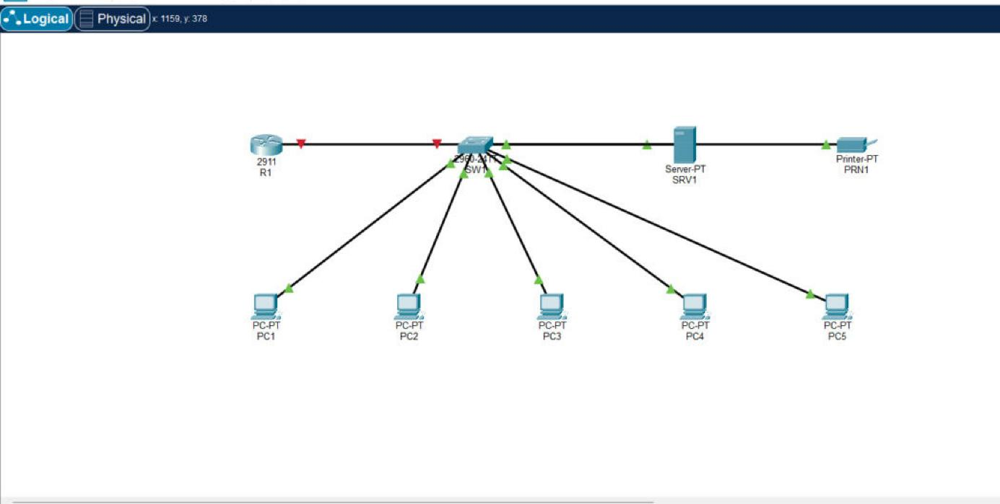

# Mạng văn phòng nhỏ trên Cisco Packet Tracer

Dự án mô phỏng một mạng văn phòng nhỏ có hai VLAN: VLAN 10 cho nhân viên và VLAN 20 cho khách. Mạng có máy chủ nội bộ chạy DHCP và DNS, một máy in dùng IP tĩnh và một access point Wi-Fi cho khách. Có 11 ca sự cố đã gây, chẩn đoán và sửa, kèm ảnh và báo cáo (ca 7 chưa có ảnh).

**[Báo cáo sự cố](docs/bao-cao-su-co.md) · [Chi tiết 11 ca](docs/incidents.md) · [File Packet Tracer](office-network.pkt)**

## Sơ đồ

| Thiết bị | Loại | Địa chỉ | Vai trò |
|---|---|---|---|
| R1 | Cisco 2911 | g0/0.10: 192.168.10.1, g0/0.20: 192.168.20.1 | Router, gateway cho hai VLAN |
| SW1 | Cisco 2960 | Không đặt IP quản lý | Switch chia VLAN |
| SRV1 | Server | 192.168.10.5 (tĩnh) | DHCP, DNS |
| PRN1 | Printer | 192.168.10.20 (tĩnh) | Máy in dùng chung |
| PC1 đến PC3 | PC | DHCP, pool OFFICE | Nhân viên, VLAN 10 |
| PC4, PC5 | PC | DHCP, pool GUEST | Khách, VLAN 20 |
| Access Point0 | Access Point | Không có IP | Phát Wi-Fi GUEST-WIFI (WPA2-PSK), nối Fa0/9 VLAN 20 |
| Smartphone0 | Smartphone | DHCP, pool GUEST | Máy khách Wi-Fi |

Dây nối: R1 g0/0 với SW1 g0/1 (trunk). SRV1 với Fa0/2, PRN1 với Fa0/3, PC1 đến PC3 với Fa0/4 đến Fa0/6, PC4 và PC5 với Fa0/7 và Fa0/8, Access Point0 với Fa0/9.

## Cấu hình chính

Switch SW1 chia cổng theo VLAN. Cổng Fa0/2 đến Fa0/6 thuộc VLAN 10 (OFFICE), cổng Fa0/7 đến Fa0/10 thuộc VLAN 20 (GUEST), cổng Gig0/1 là trunk.

Router R1 dùng kỹ thuật router-on-a-stick. Mỗi sub-interface ứng với một VLAN. Sub-interface g0/0.20 có `ip helper-address 192.168.10.5` để yêu cầu DHCP từ VLAN 20 được chuyển sang máy chủ ở VLAN 10.

SRV1 có hai pool DHCP. Pool OFFICE cấp từ 192.168.10.100, gateway 192.168.10.1, DNS 192.168.10.5. Pool GUEST cấp từ 192.168.20.100, gateway 192.168.20.1, DNS 192.168.10.5. DNS có bản ghi A cho `intranet.local` trỏ về 192.168.10.5.

## Đã kiểm tra

- `show vlan brief` trên SW1: VLAN 10 OFFICE gồm Fa0/2 đến Fa0/6, VLAN 20 GUEST gồm Fa0/7 đến Fa0/10. Ảnh: [03-vlan-brief.png](screenshots/03-vlan-brief.png).
- `show ip interface brief` trên R1: g0/0, g0/0.10 và g0/0.20 đều up/up. Ảnh: [04-ip-int-brief.png](screenshots/04-ip-int-brief.png).
- PC1 nhận DHCP đúng: 192.168.10.100, gateway 192.168.10.1, DNS 192.168.10.5.
- PC1 ping được 192.168.20.1 (gateway VLAN 20) và 192.168.10.20 (máy in), đều 4/4 gói.
- `nslookup intranet.local` trên PC1 trả về 192.168.10.5.
- PC2 và PC3 nhận pool OFFICE: 192.168.10.101 và 192.168.10.102, gateway 192.168.10.1.
- `tracert 192.168.10.5` từ PC4: chặng 1 là 192.168.20.1, chặng 2 là 192.168.10.5.
- PC4 và PC5 nhận pool GUEST qua DHCP relay: 192.168.20.100 và 192.168.20.101, gateway 192.168.20.1, DNS 192.168.10.5. Ảnh: [09-pc4-ipconfig-guest.png](screenshots/09-pc4-ipconfig-guest.png).
- Smartphone0 kết nối Wi-Fi GUEST-WIFI và nhận 192.168.20.104 từ pool GUEST. Ảnh: [23-wifi-smartphone-dhcp.png](screenshots/23-wifi-smartphone-dhcp.png).
- `tracert` từ PC4 ghi ở ảnh [20-tracert-pc4.png](screenshots/20-tracert-pc4.png).

Ảnh: [08-pc1-tests.png](screenshots/08-pc1-tests.png).

## Sự cố đã xử lý

| # | Sự cố | Chẩn đoán | Sửa |
|---|---|---|---|
| 1 | PC2 mất mạng do cổng Fa0/5 bị shutdown ([ảnh](screenshots/11-ca1-port-disabled.png)) | `show interfaces status` thấy disabled | `no shutdown` |
| 2 | VLAN GUEST không vào được web do ACL chặn nhầm ([ảnh lỗi](screenshots/10-ca2-acl-web-timeout.png)) | `show access-lists` thấy dòng deny có match ([ảnh](screenshots/10b-ca2-show-access-lists.png)) | Gỡ ACL khỏi g0/0.20 ([ảnh](screenshots/10c-ca2-web-ok.png)) |
| 3 | Máy in offline do đổi IP sang .77 ([ảnh lỗi](screenshots/12-ca3-printer-offline.png)) | Ping .20 mất gói, ping .77 có Reply | Đặt lại IP .20 ([ảnh](screenshots/13-ca3-printer-fixed.png)) |
| 4 | Không phân giải được tên do DNS sai (.99) ([ảnh lỗi](screenshots/14-ca4-dns-wrong.png)) | Ping IP được, nslookup timeout | Về DHCP, DNS .5 ([ảnh](screenshots/14b-ca4-dns-fixed.png)) |
| 5 | PC3 mất mạng do cổng Fa0/6 sai VLAN ([ảnh](screenshots/15-ca5-wrong-vlan.png)) | `show vlan brief` thấy Fa0/6 ở VLAN 20 | Đặt lại VLAN 10 |
| 6 | PC3 mất mạng do cáp đứt ([ảnh lỗi](screenshots/16-ca6-cable-removed.png)) | `show interfaces status` thấy notconnect ([ảnh](screenshots/17-ca6-fa0-6-notconnect.png)) | Nối lại cáp |
| 7 | VLAN GUEST không nhận DHCP do thiếu helper-address | PC4 báo DHCP request failed | Thêm lại `ip helper-address` trên g0/0.20 |
| 8 | Mất liên lạc với router do trunk bị đặt mode access ([ảnh lỗi](screenshots/18-ca8-trunk-access.png), [ảnh đã sửa](screenshots/19-trunk-ok.png)) | `show interfaces trunk` trống | `switchport mode trunk` |
| 9 | Ra khỏi VLAN không được do gateway cấu hình sai (.254) ([ảnh](screenshots/21-ca9-wrong-gateway.png)) | Ping máy cùng VLAN được, ping 192.168.20.1 timeout, `ipconfig` thấy gateway lạ | Về DHCP, gateway 192.168.10.1 ([ảnh](screenshots/22-ca9-gateway-fixed-dhcp.png)) |
| 10 | Điện thoại không vào được Wi-Fi do sai passphrase ([ảnh](screenshots/24-ca10-wifi-wrong-passphrase.png)) | Wi-Fi không cấp được IP, so lại passphrase với AP | Nhập đúng passphrase ([ảnh](screenshots/25-ca10-wifi-fixed.png)) |
| 11 | Điện thoại không vào được Wi-Fi do sai SSID ([ảnh](screenshots/26-ca11-wifi-wrong-ssid.png)) | Không có IP, so lại tên SSID với AP | Đặt lại SSID GUEST-WIFI |

Chi tiết từng ca và mẫu ticket: [docs/incidents.md](docs/incidents.md). Báo cáo tổng hợp: [docs/bao-cao-su-co.md](docs/bao-cao-su-co.md).

## Ghi chú

Packet Tracer không tái hiện được lỗi sai subnet mask (đặt 255.255.255.252 vẫn ping được gateway) nên lỗi này không đưa vào. Lỗi IP trùng chưa làm.

Pool `serverPool` mặc định của SRV1 không xóa được qua giao diện Packet Tracer. Pool này được để lại với gateway 192.168.10.1, DNS 192.168.10.5 và dải bắt đầu từ 192.168.10.200, nên không đụng vùng OFFICE.

File mạng: [office-network.pkt](office-network.pkt).
